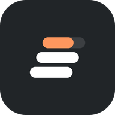
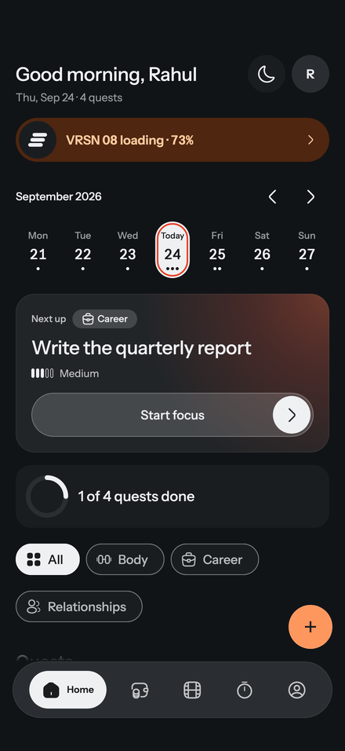
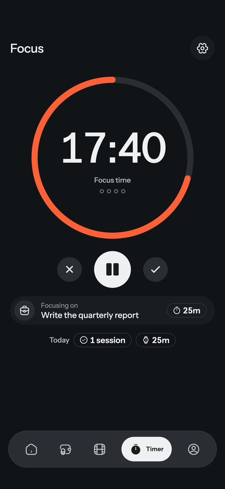
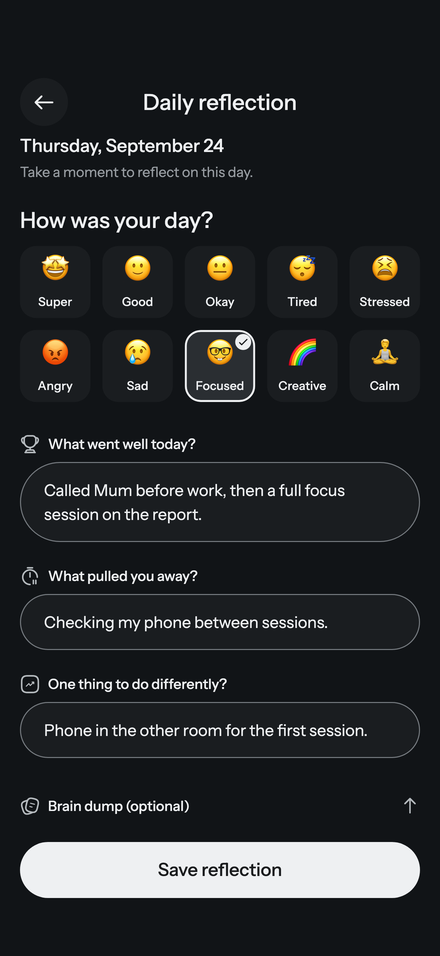
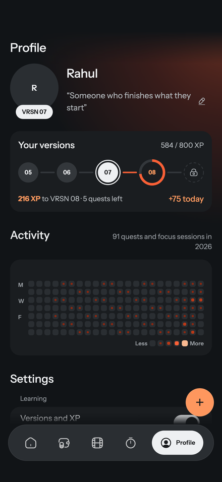
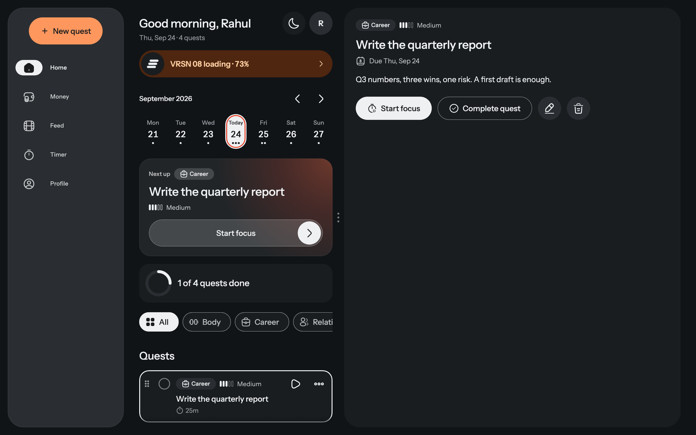

<p align="center">
  
</p>

<h1 align="center">VRSN</h1>

<p align="center">
  <b>Build your next version.</b><br>
  Small quests, a focus timer and three questions at night. Built with ADHD brains in mind.<br>
  Said "version". Works offline. No account needed to start.
</p>

<p align="center">
  <a href="https://github.com/rahulrajsbkk/vrsn-releases/releases/latest"><b>Download the latest</b></a>
  ·
  <a href="https://vrsn.rahulrajsb.me">Open it in your browser</a>
  ·
  <a href="https://get.vrsn.rahulrajsb.me">Website</a>
</p>

<p align="center">
  
  
  
  
</p>

## What it does

- **Do.** Start with who you're becoming, then break it into quests you could finish before dinner, each with an energy level, a day and a gentle nudge.
- **Focus.** 25 minutes on one quest, with short and long breaks built in. On your phone, Go Dark turns the screen black so it stops asking for your attention.
- **Reflect.** Pick a mood, name today's win, what pulled you off track and one change for tomorrow. Then empty your head into the brain dump.
- **See it.** Every finished quest is worth 50 XP and every focus minute is worth 1. Fill the bar and VRSN 07 becomes VRSN 08. Missed a day? Your progress stays.

<p align="center">
  
</p>

## Download

Every file is on the [latest release](https://github.com/rahulrajsbkk/vrsn-releases/releases/latest).

| Screen | Get it |
|---|---|
| **Android** | The `.apk` on the latest release |
| **Mac** | The `-macos.zip` on the latest release |
| **Web** | [vrsn.rahulrajsb.me](https://vrsn.rahulrajsb.me). To keep it like an app, choose Install from your browser's menu |
| **iPhone and iPad** | Invite-only on TestFlight. [Request an invite](https://get.vrsn.rahulrajsb.me/#invite) |
| **Google Play** | Invite-only for now. [Request an invite](https://get.vrsn.rahulrajsb.me/#invite) |
| **Windows and Linux** | Not ready yet |

### Installing on Android

1. Download the APK on your phone and open it.
2. If Android asks, let your browser install apps.
3. Open VRSN.

In some countries, India among them, Google Play Protect may block installing the APK from a browser, because VRSN can read bank messages for Money. Keep Play Protect on. If it blocks the install, install from a computer instead: turn on USB debugging, connect the phone and run `adb install` with the APK.

VRSN only asks about SMS if you turn on bank message capture in Money, and the messages never leave your phone.

### Installing on a Mac

1. Download the zip, unzip it and drag VRSN into Applications.
2. Open it. The first time, macOS may say it can't check the developer: open System Settings › Privacy & Security, scroll down and choose Open Anyway. You only do this once.

The Mac download works offline on your Mac. Sync comes with the App Store version.

### Checking a download

Each release lists the SHA-256 of every file. The Android APK is always signed with the same certificate:

```
01:23:95:3e:35:9e:50:be:83:30:e2:f0:47:cc:9b:a1:ae:29:b3:fd:57:b4:9d:82:55:6c:e7:1e:fc:8d:6b:09
```

## Yours, not ours

- No ads, no trackers, no analytics.
- Works offline. As a guest, your data never leaves your device.
- AI only writes your Feed cards. It never reads your quests, journal or money.
- Delete your account from the app, any time.

[Privacy policy](https://get.vrsn.rahulrajsb.me/privacy) · [Terms](https://get.vrsn.rahulrajsb.me/terms) · [Install help](https://get.vrsn.rahulrajsb.me/download) · [Help](https://get.vrsn.rahulrajsb.me/support) · [support@rahulrajsb.me](mailto:support@rahulrajsb.me)

VRSN is for anyone 18 or older. It's built with ADHD brains in mind, but it isn't a medical app and doesn't diagnose or treat anything.

## Support VRSN

If VRSN helps you, you can buy its developer a coffee.

<a href="https://buymeacoffee.com/rahulrajsb"></a>

---

This repository holds VRSN's public downloads. The app's source code isn't public.
